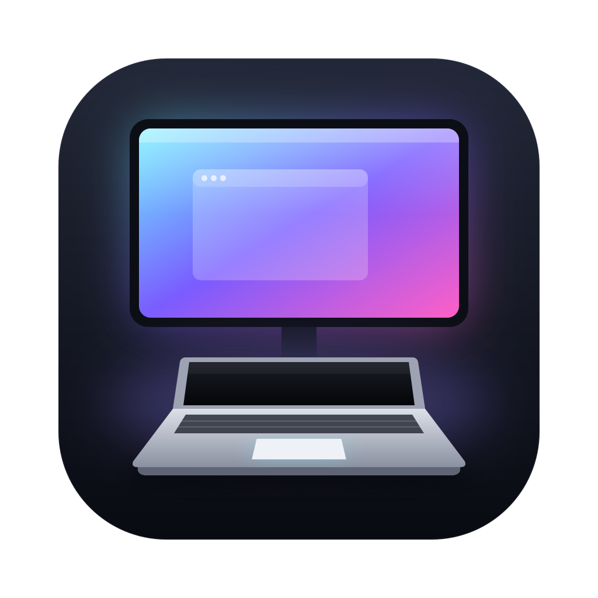

<p align="center">
  
</p>

<h1 align="center">Lidless</h1>

<p align="center">
  Closed-lid mode for a MacBook whose lid is open.<br>
  Turn off the built-in display from the menu bar and keep using the keyboard and trackpad.
</p>

<p align="center">
  
  
  
</p>

---

You run your MacBook on an external monitor with the lid half-open, so you can still use the built-in keyboard and trackpad. The internal screen is out of sight, but macOS keeps treating it as a second display. New windows open there, dialogs show up there, and the cursor drifts onto it.

Closing the lid fixes that, but then you can't reach the keyboard.

Lidless gives you closed-lid behavior with the lid open. Turn it on, and the built-in display goes dark and drops out of macOS's display list, exactly as if you'd shut the lid. Everything moves to the external display, and the keyboard and trackpad keep working.

## Usage

Click the laptop icon in the menu bar, or press <kbd>⌃</kbd><kbd>⌥</kbd><kbd>⌘</kbd><kbd>L</kbd> anywhere.

| Menu item | What it does |
| --- | --- |
| **External Only Mode** | Turns the built-in display off while an external display is connected. |
| **Launch at Login** | Starts Lidless when you log in. |
| **Quit Lidless** | Quits Lidless and turns the built-in display back on. |

The setting is remembered after a restart. The icon shows a crossed-out laptop while the built-in display is off.

## You can't end up without a screen

Lidless only keeps the built-in display off while an external display is connected. It checks again every time the display setup changes:

- **Unplug the external display** and the built-in display comes straight back. Plug it in again and it goes dark again, as long as the mode is still on.
- **Quit Lidless**, from the menu or with `kill`, and the built-in display comes back.
- **Wake from sleep** and Lidless applies your setting again.
- **Log out or restart** and macOS turns the built-in display back on, because the change only lasts for the current session.

If Lidless is force-killed (`kill -9`) or crashes while the display is off, open Lidless again or log out.

## Install

Build from source. You need the Xcode Command Line Tools (`xcode-select --install`).

```bash
git clone https://github.com/elix1er/lidless.git
cd lidless
./build.sh --install
```

This builds `Lidless.app`, copies it to `/Applications` and opens it. Run `./build.sh` without `--install` to build into `build/` only.

The app is signed ad hoc on your own machine, so Gatekeeper doesn't block it.

## How it works

macOS has a documented API for display configuration, but it can't take a display offline. Lidless calls `CGSConfigureDisplayEnabled`, a private CoreGraphics function that takes a display offline the way closing the lid does. Display utilities such as BetterDisplay use the same call for their "disconnect display" feature.

The rest of the app is plain AppKit:

- One function decides the outcome: the built-in display should be off only when the mode is on *and* an external display is online. Every event (toggle, display plugged in or unplugged, wake) runs that same check.
- `CGDisplayRegisterReconfigurationCallback` reports display changes, and each burst of events is handled once.
- The global shortcut is a Carbon hot key, so Lidless needs no Accessibility permission.
- `SIGTERM`, `SIGINT` and `SIGHUP` go through the normal quit path, which turns the display back on.

The private function is looked up when Lidless starts. If a future macOS release removes it, Lidless tells you and quits instead of crashing.

### Debug tool

`build.sh` also builds `build/displaytool`, a small command-line tool for checking that switching works on your Mac:

```bash
build/displaytool list      # displays macOS has online
build/displaytool off 10    # built-in display off, back on after 10 seconds
build/displaytool on 1      # turn display 1 back on
```

## Compatibility

Developed and tested on macOS 27 on an Apple silicon MacBook Pro with one HDMI display. It needs macOS 13 or later for Launch at Login. Intel Macs and setups with several external displays should work too, but haven't been tested.

Lidless relies on a private API, so a future macOS update could break it. If that happens, please open an issue.

## Project layout

```
Sources/Display.swift          display control, shared by the app and the CLI
Sources/main.swift             menu bar app
Tools/displaytool/main.swift   debug CLI
Resources/                     Info.plist and app icon
Assets/                        icon source (SVG) and make-icon.sh
build.sh                       build, and optionally install
```

## License

[MIT](LICENSE)
